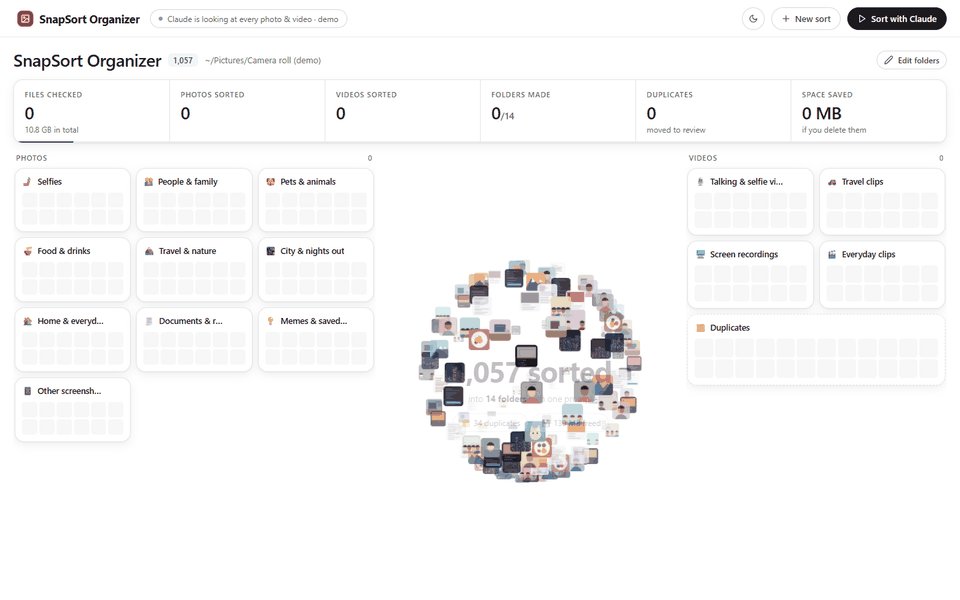
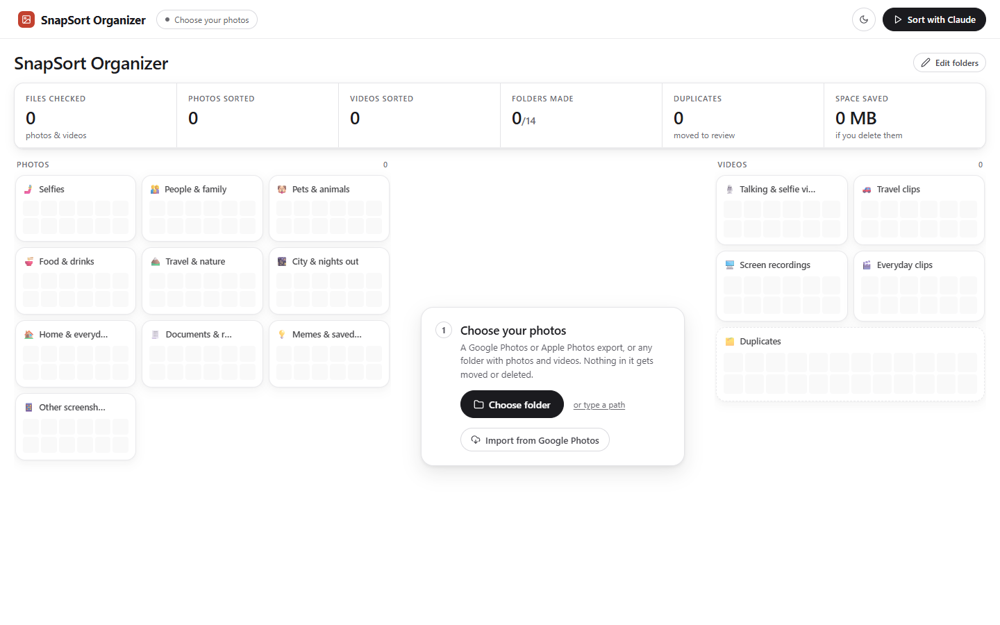
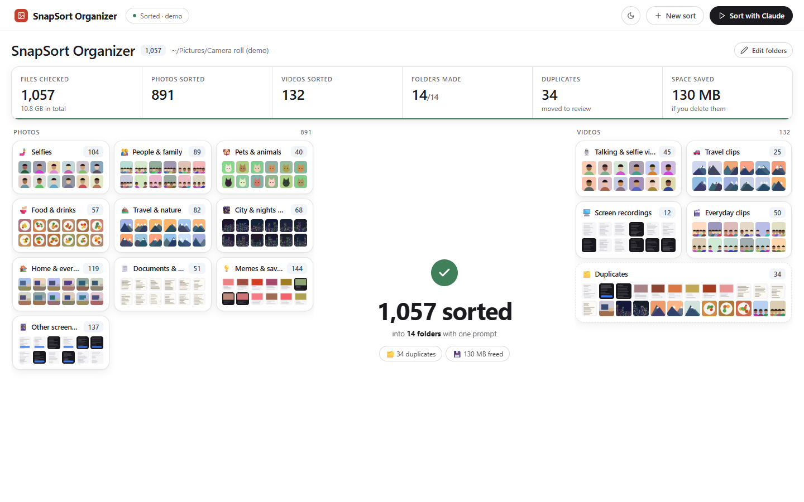
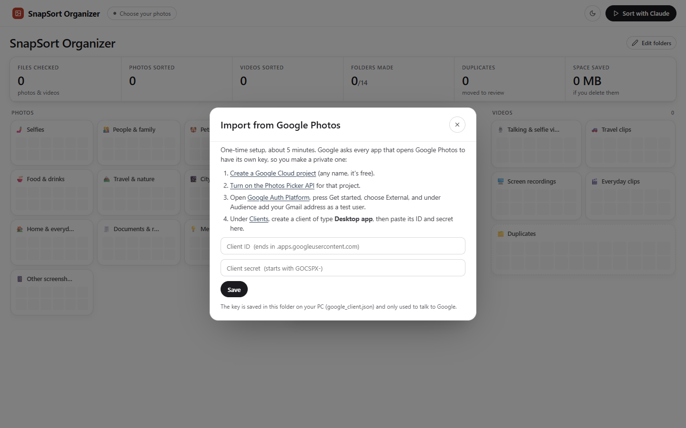
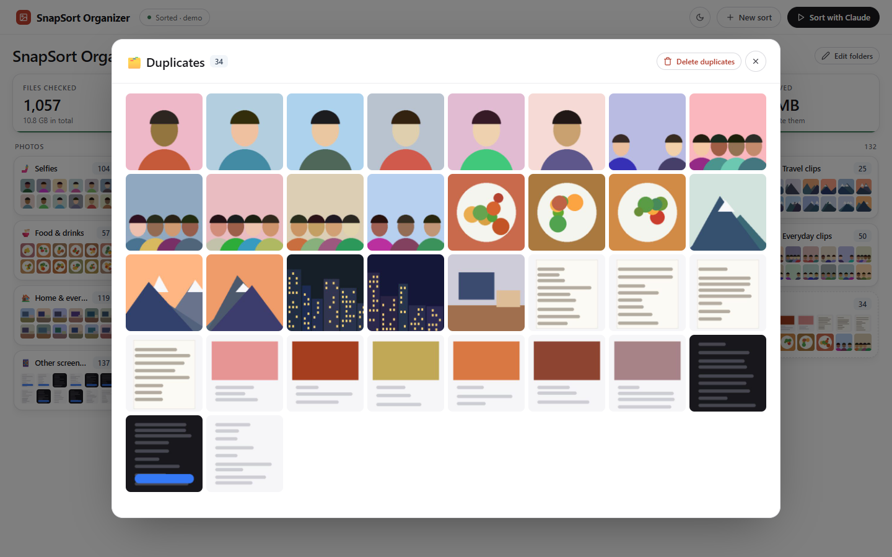
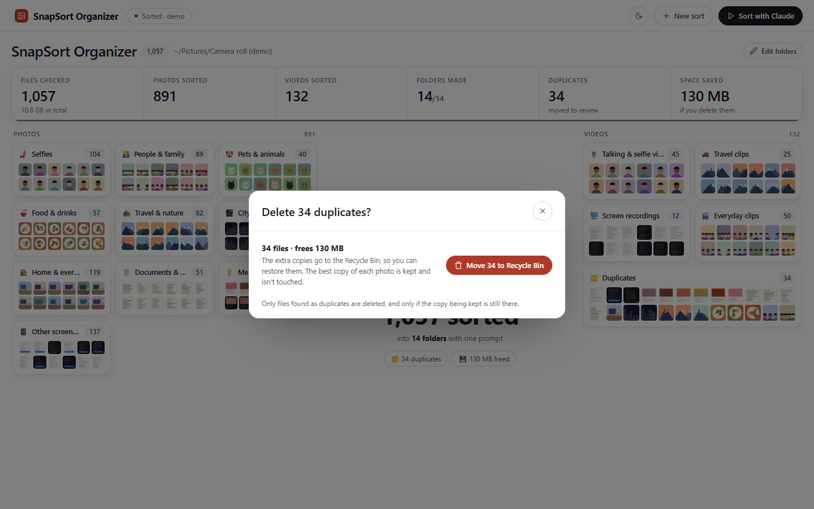
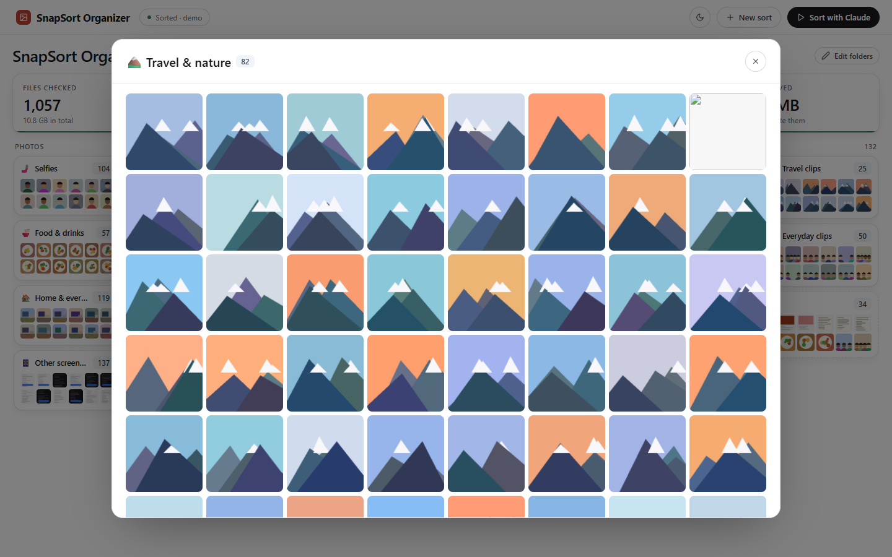
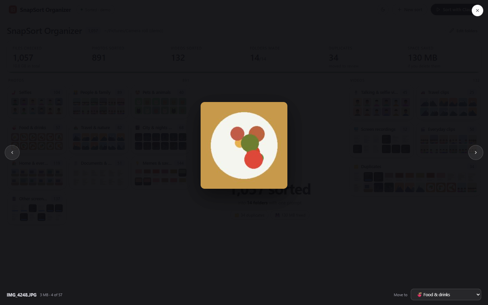
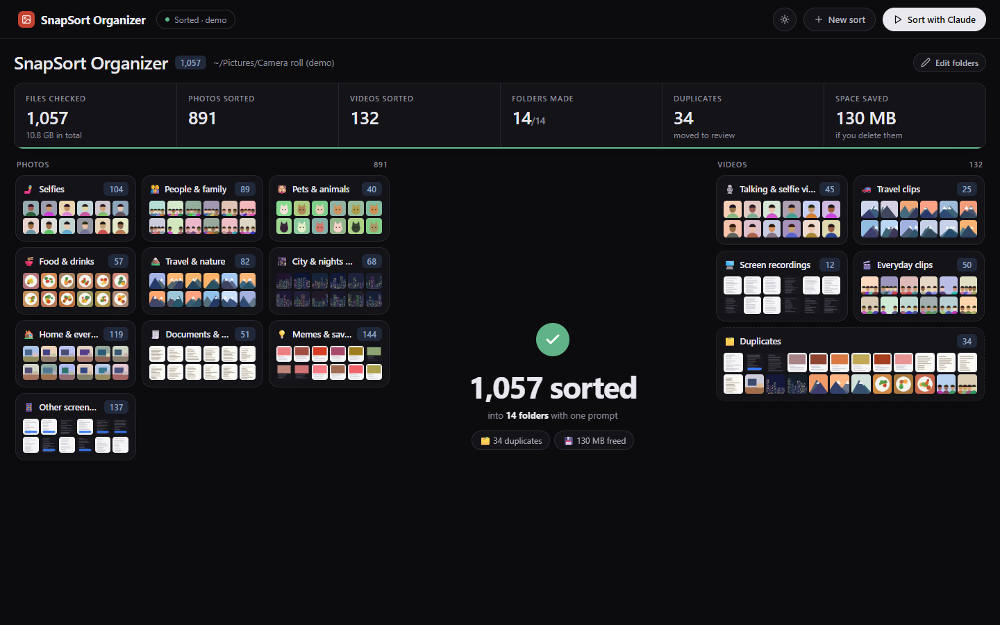

# SnapSort Organizer

SnapSort Organizer sorts your photos on Windows. It started as a Windows port of [claude-photo-sorter](https://github.com/kairothq/claude-photo-sorter). Point it at a Google Photos export, an Apple Photos / iCloud export, or any folder. Claude looks at every photo and video, sorts copies into folders, finds duplicates, and you watch it happen on a dashboard in your browser.



<sub>Screenshots use the built-in demo (`Demo.bat`): the "photos" are drawn shapes, not real pictures.</sub>

- **Sorts photos and videos** into folders like Selfies, Food, Travel, Screenshots, Talking heads and Screen recordings. Use the standard folders or make your own.
- **Imports from Google Photos**: sign in, pick photos in Google's own picker, and they're downloaded and sorted.
- **Finds duplicates**: identical copies, burst shots and re-saved screenshots go to `_Review\duplicates`, with a list of which copy was kept. One click sends the extra copies to the **Recycle Bin**.
- **Never changes your originals on its own.** It only reads them and makes sorted copies. The only thing that removes files is **Delete duplicates**, when you press it, and that goes to the Recycle Bin.
- **Runs on your computer.** Your photos are not uploaded anywhere.

## Start here

You need Windows 10 or 11 and [Claude Code](https://claude.com/claude-code) (it labels the photos with your Claude plan, no API key).

1. Double-click **`Open SnapSort Organizer.bat`**.
   The first time, it sets itself up: if Python is missing it offers to install Python 3.12 with `winget`, then installs three small Python packages. It also offers ffmpeg for video previews (optional).
2. The dashboard opens at **http://127.0.0.1:8765**. Keep the black window open while you sort.
3. Click **Choose folder** and pick your photos, choose where the sorted copies go (the default is right next to your photos, e.g. `D:\Takeout (sorted)`), then press **Start sorting**.

About 4 minutes for 1,000 photos. Want a look first without your own photos? Double-click **`Demo.bat`**.



When it's done, every folder shows its photos and the total sorted:



### Getting your photos onto the PC

| From | How |
|---|---|
| **Google Photos (sign in)** | Press **Import from Google Photos**. See [Google Photos sign-in](#google-photos-sign-in) below. |
| **Google Photos (whole library)** | [takeout.google.com](https://takeout.google.com), select only Google Photos, download, then right-click each zip › **Extract All** into one folder. The `.json` files Takeout adds are used for the date taken and location. |
| **iPhone / iCloud** | Install *iCloud for Windows* (Microsoft Store), turn on Photos, and use the iCloud Photos folder. Or plug in the iPhone and import with the Windows **Photos** app. |
| **Apple Photos on a Mac** | Select all, File › Export › Export Unmodified Originals, and copy the folder over. |
| **Anything else** | Any folder with photos and videos, including subfolders. |

HEIC photos from iPhones work out of the box. Zip files are skipped (the dashboard tells you if it sees some).

## Google Photos sign-in

Press **Import from Google Photos** on the first screen.



**What Google allows** (its rules since 31 March 2025, the same for every app):
- Apps can only see the photos **you pick** in Google's own Photos Picker, up to 2,000 per round. Import again for more; photos already downloaded are skipped.
- Apps **cannot delete, move or re-album** photos inside Google Photos. So SnapSort Organizer downloads the photos you pick (full quality; Google removes the location from downloads) into `Pictures\Google Photos (SnapSort Organizer)` and sorts those copies. Your Google Photos library is never changed.
- Deleting duplicates here deletes the downloaded copies on your PC. To free space in Google Photos, delete the same files there too: their names are in `duplicates.csv`.
- For your **whole** library with dates and locations, Google Takeout (above) is still the better route.

**One-time setup (about 5 minutes).** Google requires each app that opens Google Photos to have its own key, so you make a free private one:
1. [Create a Google Cloud project](https://console.cloud.google.com/projectcreate) (any name).
2. [Turn on the Photos Picker API](https://console.cloud.google.com/apis/library/photospicker.googleapis.com) for it.
3. Open [Google Auth Platform](https://console.cloud.google.com/auth/overview), press **Get started**, choose **External**, and under **Audience** add your Gmail address as a test user.
4. Under [Clients](https://console.cloud.google.com/auth/clients), create a client of type **Desktop app**. Paste its ID and secret into the dashboard.

Then press **Sign in with Google**. Google will say the app isn't verified, because it's your private app; press **Continue**. The key is saved in `google_client.json` and the sign-in in `work\google_token.json`, both only on this PC. **Sign out** in the same dialog removes the sign-in and revokes it at Google.

## Deleting duplicates

Click the **Duplicates** folder, then **Delete duplicates** (or **Delete** on one photo in the full-size view). You see how many files and how much space before anything happens. The extra copies, and their copies in `_Review\duplicates`, go to the **Recycle Bin**, so you can restore them. The copy being kept is never touched, and a duplicate is only deleted while its kept copy still exists. On a drive with no Recycle Bin, Windows asks before deleting permanently.

| The Duplicates folder | Before anything is deleted |
|---|---|
|  |  |

## The dashboard

| | |
|---|---|
| **Sort with Claude** | Before sorting: asks for anything missing, then starts. After sorting: replays the animation. Add `?d=20` to the address for a slower take. |
| **New sort** | Pick a new photos folder and a new place for the copies. |
| **Advanced** | See the folders that will be made, remove any, or press **+** to add your own. Choose Claude or Jev. Try 200 photos first. |
| **Click a folder** | Browse it. Click a photo for full size, flip with the arrow keys, and **Move to** another folder if it's wrong (the sorted copy moves too). |
| **Edit folders** | Rename folders and describe what goes in each. |
| **Open sorted folder / Open in Explorer** | Opens the result in File Explorer. **Show original** opens Explorer with the original selected. |
| **Moon button** | Dark mode. |

| Browsing a folder | Full-size view with Move to |
|---|---|
|  |  |



## How it works

1. **Scan**: a small preview and a fingerprint of every file. Dates come from the Takeout `.json` sidecar or the photo's EXIF.
2. **Duplicates**: compares fingerprints, plus a pixel check for screenshots so similar app screens aren't mistaken for copies.
3. **Labels**: runs Claude Code in the background (`claude -p`), four at a time, each looking at about 90 previews.
4. **Folders**: copies each file into its folder, duplicates into `_Review\duplicates`, and writes `sorted.csv` and `duplicates.csv` (they open in Excel).

Jev (TypeSafe, paid per file) is available under Advanced as in the original: put `JEV_KEY=your-key` in a `.env` file in this folder.

## What changed from the Mac version

- `Open SnapSort Organizer.bat`, `Demo.bat` and `start.ps1` replace `setup.sh`, `start.sh` and the `.command` file, and install Python/ffmpeg via winget if needed.
- Native Windows folder picker, File Explorer instead of Finder.
- UTF-8 everywhere, so emoji folder icons and non-English file names don't crash on Windows.
- The Claude prompt goes through stdin (Windows mangles long command lines), and `claude.exe` is found in `%USERPROFILE%\.local\bin` even if PATH isn't updated yet.
- Folder names are made safe for Windows, long Takeout paths (over 260 characters) still copy, and CSVs open cleanly in Excel.
- Better Google Takeout support: `.supplemental-metadata.json` sidecars, cut-short names, `(1)` copies and `-edited` files. EXIF dates and GPS for everything else.
- Scans skip the Recycle Bin, hidden folders, earlier sorted output and the sorter's own folder.
- Moving a photo in the dashboard also moves its sorted copy.
- A faster duplicate check.

## Running it by hand (PowerShell)

```powershell
.\start.ps1 -Setup                                   # install / repair only
.\start.ps1                                          # open the dashboard
$env:PORT = 8766; .\start.ps1                        # if port 8765 is busy
.venv\Scripts\python scripts\scan.py "D:\Takeout" --limit 200
.venv\Scripts\python scripts\dupes.py
.venv\Scripts\python scripts\label_claude.py
.venv\Scripts\python scripts\apply.py "D:\Takeout (sorted)"
```

## Privacy

The dashboard only listens on `127.0.0.1`. Previews, labels and the file list stay in `dashboard\data\` and `work\`. Claude Code reads only the small previews; originals never leave your computer. With Google Photos, the app only talks to Google to sign in and download the photos you picked.

## License

MIT (same as the original).
